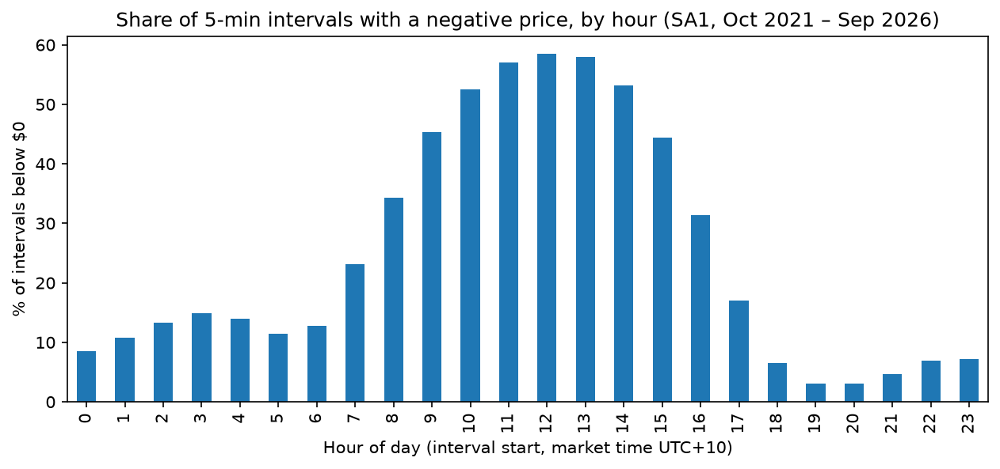
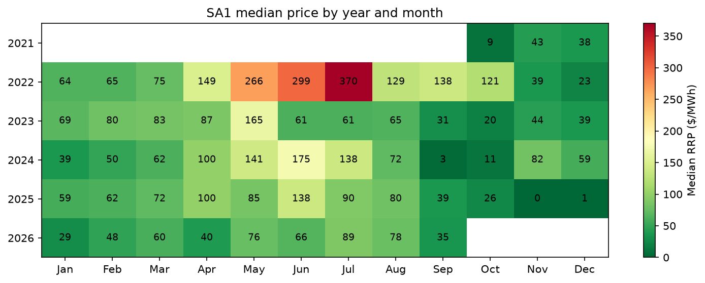
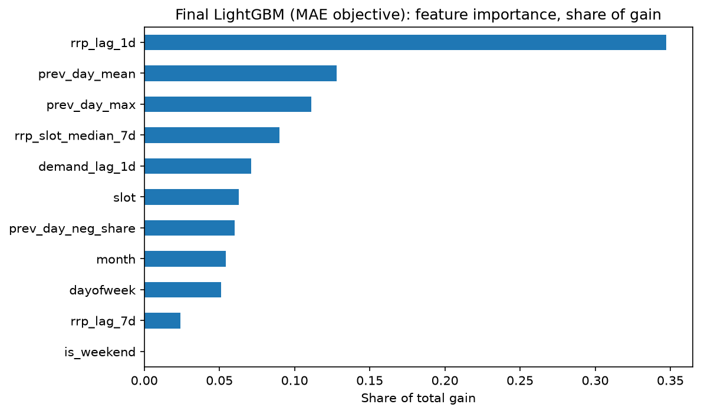
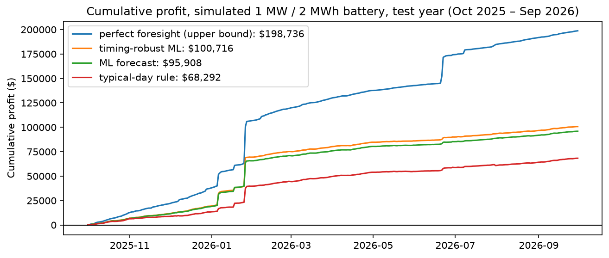

# Intelligent Battery Trading in South Australia

**Probabilistic electricity price forecasting, risk modelling and battery dispatch optimisation on five years of real AEMO data.**

> **Headline result (held-out test year, Oct 2025 – Sep 2026):** a LightGBM forecast combined with a timing-robust linear-programming optimiser earned **$100,716** for a simulated 1 MW / 2 MWh battery, **47.5% more** than a typical-day rule ($68,292), with a smaller worst day (−$241 vs −$924) and fewer losing days (11.8% vs 17.5%).

---

## 1. Business problem

South Australia has one of the most volatile wholesale electricity markets in the world, driven by very high wind and rooftop solar. A battery can earn money through **arbitrage**: charge when prices are low (often negative at midday) and discharge when they are high (the evening peak).

But future prices are uncertain, the battery has physical limits, and a wrong decision costs money.

**Question:** can probabilistic forecasting and optimisation help a battery operator make better trading decisions than simple rules?

| | Research question |
|---|---|
| **RQ1** | Can short-term electricity prices be forecast from historical market data? |
| **RQ2** | Can forecast uncertainty and the probability of extreme prices be quantified? |
| **RQ3** | Can forecasts and battery constraints be turned into a charge/discharge schedule? |
| **RQ4** | Do forecast-driven strategies improve simulated profit and risk compared with simple baselines? |

## 2. Data

| | |
|---|---|
| Source | Australian Energy Market Operator (AEMO), aggregated price and demand data |
| Region | South Australia (`SA1`) |
| Period | October 2021 – September 2026 (all under 5-minute settlement) |
| Size | 525,888 five-minute intervals |
| Quality | Validated: 0 duplicates, 0 missing intervals, constant 5-minute spacing |

Data © AEMO, used under the AEMO Copyright Permissions Notice. Raw data is not committed to this repository; see *Reproduce* below.

Key data decisions are documented in [`docs/decision_log.md`](docs/decision_log.md), and column definitions in [`docs/data_dictionary.md`](docs/data_dictionary.md).

## 3. What the data shows

- **Prices are heavily skewed:** median $67.58/MWh, mean $98.74/MWh, ranging from the −$1,000 market floor to the $20,300 market cap.
- **Negative prices are common:** 24.7% of all intervals, and more than 50% of midday intervals (10:00–14:00), versus about 3% in the evening peak. This daily cycle is the arbitrage opportunity.
- **Grid demand can be negative:** down to −311 MW on Christmas Day 2025, when rooftop solar exceeded all of South Australia's consumption. These are real events, not errors, and were kept.
- **The market is non-stationary:** the 2022 energy crisis created a very different price regime, and spring prices have fallen towards zero over time.





## 4. Method

**Forecast setup:** at midnight (market time), forecast all 48 half-hourly prices of the next day. Every feature is known at midnight, which rules out leakage by design; this was verified with manual spot checks.

**Features:** calendar (half-hour of day, weekday, month), lags (same half-hour yesterday and last week), a 7-day same-slot median, and previous-day summaries (mean, maximum, share of negative prices, demand).

**Validation:** chronological split, never random.

| Set | Period | Use |
|---|---|---|
| Train | Oct 2021 – Sep 2024 | Model fitting |
| Validation | Oct 2024 – Sep 2025 | Model and strategy selection |
| Test | Oct 2025 – Sep 2026 | Final evaluation, run once |

**Models:** naive and seasonal baselines → linear regression (OLS, Huber) → LightGBM (MAE objective) → quantile LightGBM (10th/50th/90th percentiles) → LightGBM spike classifier (price > $300).

**Battery optimisation:** a linear program (SciPy `linprog`, HiGHS) maximises daily profit subject to power (1 MW), capacity (2 MWh), 90% round-trip efficiency and a $10/MWh degradation cost. Each schedule is planned from **forecasts** at midnight and paid at **actual** prices.

## 5. Results

### Forecast accuracy (RQ1), test year

| Model | MAE ($/MWh) | RMSE ($/MWh) |
|---|---|---|
| **LightGBM** | **58.11** | 415.52 |
| 7-day same-slot median (best baseline) | 65.62 | 420.06 |
| Global median | 75.43 | 420.52 |

LightGBM is **11.4% more accurate** than the best baseline (9.4% on validation, so the gain generalised). RMSE barely improves: extreme spikes remain essentially unpredictable from day-ahead information.



### Uncertainty (RQ2), validation year

- **Spike model (price > $300):** ROC AUC 0.874, Brier skill score 0.157 against a base-rate baseline. It ranks risky half-hours well, but overestimates risk in its highest-risk bin (about 17% predicted vs 9.5% observed), likely because training includes the 2022 crisis.
- **80% prediction intervals:** raw quantile intervals covered only 68.4% of actual prices, so they were overconfident, especially overnight (about 62%). Conformal calibration is designed as the correction.

### Business value (RQ4), test year

| Strategy | Total profit | Capture of perfect foresight | Worst day | Losing days |
|---|---|---|---|---|
| Perfect foresight (upper bound) | $198,736 | 100% | +$8 | 0% |
| **Timing-robust ML** | **$100,716** | **50.7%** | −$241 | **11.8%** |
| ML forecast | $95,908 | 48.3% | −$210 | 13.2% |
| Typical-day rule | $68,292 | 34.4% | −$924 | 17.5% |
| No trade | $0 | — | — | — |



**Honest reading of the result:**

- The timing-robust ML strategy beat the typical-day rule in **8 of 12** test months; the four losing months were all within $164.
- **January 2026 accounts for 73% of the advantage** (a month including a price-cap event). Excluding it, ML still earned **20.6% more** over the other 11 months.
- The typical-day rule's capture fell from 55.7% on validation to 34.4% on test: a fixed historical pattern degrades as the market changes, while forecasts adapt.

## 6. Key lessons

1. **Median for accuracy, mean for decisions.** An MAE-optimal forecast predicts the median, which undervalues spike-prone evenings.
2. **Timing matters more than level.** On 1 February 2025, a forecast-driven battery planned its discharge about an hour too late and missed a $15,900/MWh spike. Point-forecast optimisation concentrates risk in one predicted hour; smoothing the forecast over ±30 minutes spreads it.
3. **Aggregates hide what matters.** 10 days (2.7% of the validation year) caused 26% of forecast error, and single days could swing strategy rankings by $10,000.
4. **Test ideas, keep the honest ones.** A spike-probability adjustment was tried and rejected; it added almost nothing.

## 7. Limitations

- A simplified battery: daily planning, starting and ending empty, no cycle limits beyond a degradation cost.
- The battery is assumed to be a **price-taker**: its trades do not affect market prices.
- Day-ahead planning only; real batteries re-optimise continuously and also earn from ancillary (FCAS) markets.
- No network charges, bidding rules or regulatory detail.
- Results are **simulated** on historical data and are not real trading performance.

## 8. Future work

- Weather and wind generation features (to address night-time negatives and heat-driven spikes)
- Conformal calibration of intervals, verified on the test year
- Intraday re-optimisation as new prices arrive
- Scenario-based or stochastic optimisation using full price distributions

## 9. Reproduce

```bash
python -m venv .venv
# Windows: .venv\Scripts\activate    Mac/Linux: source .venv/bin/activate
python -m pip install -r requirements.txt
python -m pip install -e .
python src/nem_battery/download.py
```

Then run the notebooks in order (`01` → `10`). To regenerate the README charts:

```bash
python scripts/make_figures.py
```

## Repository structure

```
data/            raw / interim / processed (not committed)
docs/            decision log, data dictionary, market background
notebooks/       01–10: download, validation, EDA, features, models, uncertainty, battery, final test
reports/figures/ charts used in this README
scripts/         make_figures.py: regenerates the README charts
src/nem_battery/ download, load, features, evaluate, battery
```

---

*Built by Quinn Pham, Master of Data Science, University of Adelaide.*
